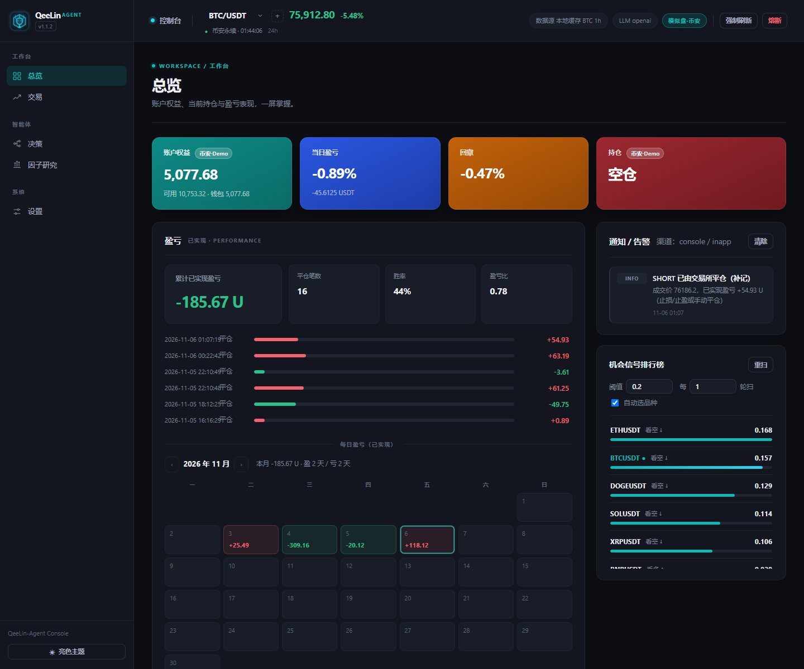
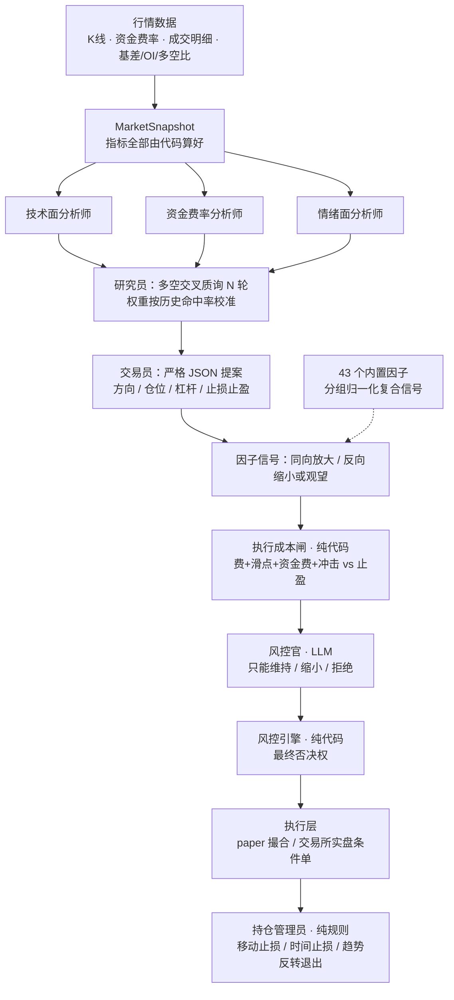
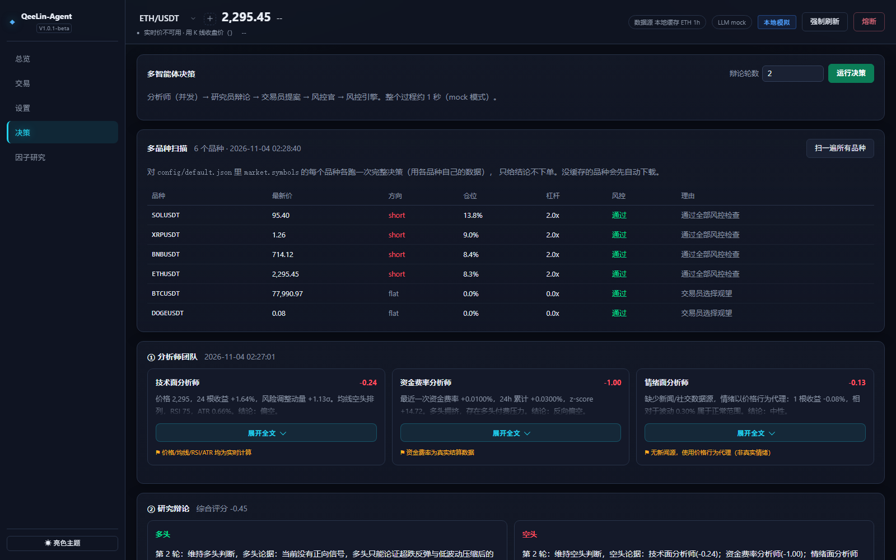
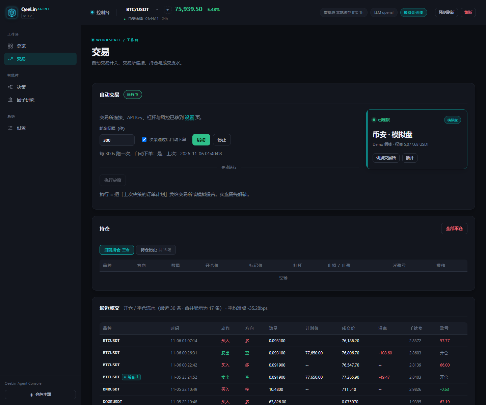
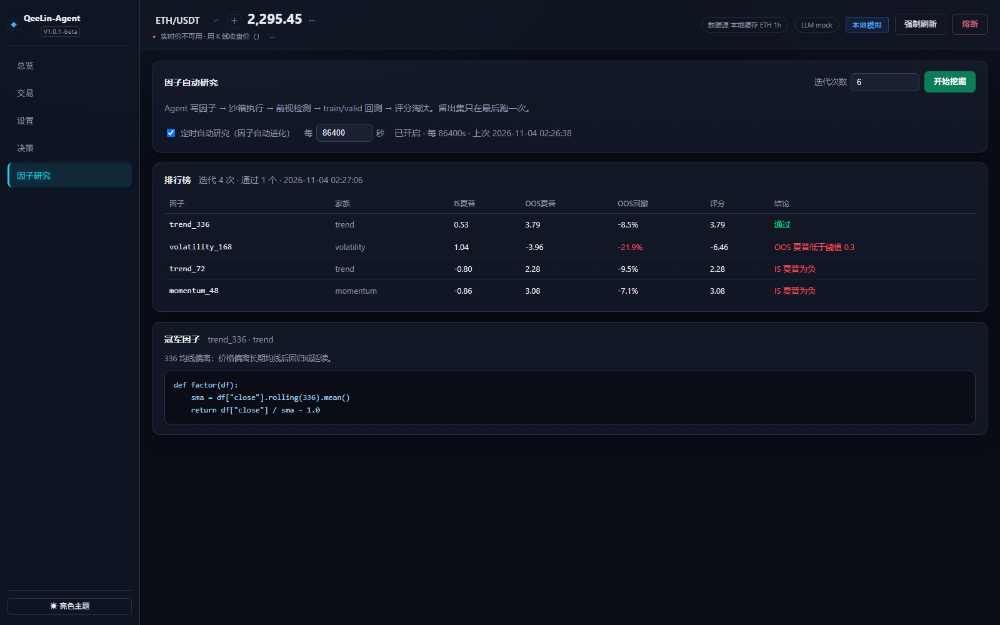
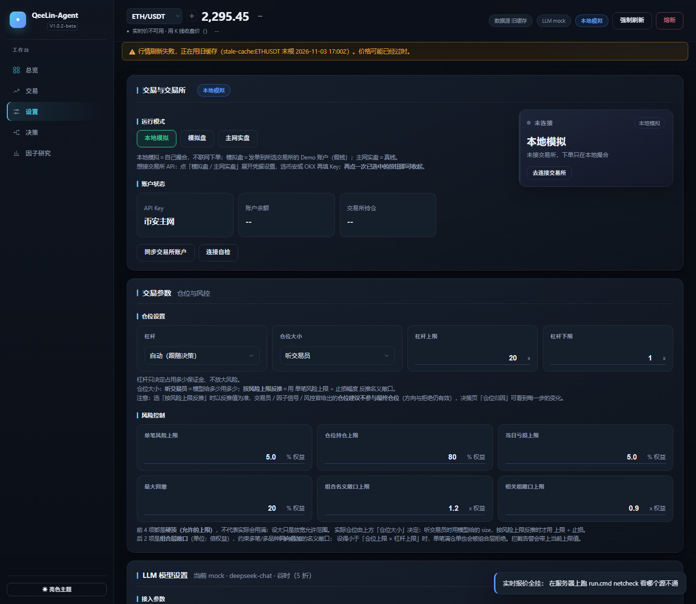

# QeeLin-Agent

<p align="center">
  <a href="LICENSE"></a>
  
  
  
</p>

币圈永续合约的**多智能体交易框架 + 自动因子研究循环**。

决策链：三位分析师并发 → 多空辩论 → 交易员输出 JSON 提案 → **执行成本闸**（纯代码）→ 风控官 → **确定性风控引擎终审**；开仓之后由**持仓管理员**接管退出决策。研究循环让模型自己写因子、跑回测，按样本外表现决定是否晋级。

> 核心原则：数字由代码算，语言交给模型。LLM 负责解释与权衡，不负责算术，也没有下单权限。开仓后的移动止损、时间止损、趋势反转退出，以及成本/流动性检查，全部是确定性代码。

> **v1.1.0-Beta**：现代 SaaS 控制台视觉重做（分组侧栏、五个页签、双主题），并延续 v1.0.2 的持仓管理员（退出决策）、执行成本闸、43 个内置因子（含基差 / 持仓量 / 多空比等衍生品维度）与分析师权重事后校准；同时修正了默认风控上限自相矛盾的问题（组合 / 相关敞口上限已与单笔名义上限对齐）。



---

## 目录

- [设计原则](#设计原则)
- [核心特性](#核心特性)
- [架构](#架构)
- [快速开始](#快速开始)
- [命令](#命令)
- [Web 控制台](#web-控制台)
- [运行模式与安全闸门](#运行模式与安全闸门)
- [风控体系](#风控体系)
- [持仓管理与执行成本闸](#持仓管理与执行成本闸)
- [分析师权重校准](#分析师权重校准)
- [因子研究循环](#因子研究循环)
- [交易所支持](#交易所支持)
- [LLM 与成本控制](#llm-与成本控制)
- [通知](#通知)
- [配置](#配置)
- [目录结构](#目录结构)
- [测试](#测试)
- [已知限制](#已知限制)

---

## 设计原则

| 原则 | 落地方式 |
|---|---|
| **数字归代码** | 价格、均线、ATR、资金费率 z-score、仓位、盈亏、回撤全部由 pandas 计算后喂给模型；模型只输出判断与理由 |
| **确定性兜底** | 每个角色都有规则化实现：没配 Key、网络失败、输出不合规都会自动降级，流水线不中断，报告标注「LLM 降级」 |
| **偏保守的默认** | 默认 `paper` + `mock` 模式，开箱即跑、零成本、不联网下单；实盘需要显式解锁 |
| **可插拔** | LLM / 交易所 / 通知 / 情绪源任一缺失都能降级运行 |
| **可审计** | 每次决策落盘为 JSON + Markdown，成交记录保留计划价、滑点、手续费与已实现盈亏 |

---

## 核心特性

- **多智能体决策链**：技术面 / 资金费率 / 情绪面三位分析师并发，多空双方交叉质询，交易员输出严格 JSON 提案，风控官独立复核；分析师权重会按历史方向命中率事后校准。
- **独立风控引擎**：纯代码实现，拥有最终否决权；风控官只能维持、缩小或拒绝提案，**不能放大**。
- **持仓管理员**：开仓后不再只靠静态条件单——浮盈达 1R 后移动止损保本并跟踪 ATR 极值、横盘超时退出、趋势反转或因子强反向提前退出。实盘会撤旧条件单重挂，挂单失败自动回退旧止损。
- **执行成本闸**：开仓前用代码核算手续费、滑点、资金费与冲击成本，净边际为负或参与率过高直接拒绝/缩仓。
- **自动因子研究**：模型写因子代码 → AST 白名单 + 独立子进程沙箱 + 未来函数检测 → 训练/验证/测试三段回测 → 按样本外夏普加权晋级。
- **43 个内置因子**：21 个经典 OHLCV 因子 + 13 个微观结构因子 + 4 个主动买卖/成交明细因子 + 5 个衍生品因子（基差、持仓量、taker 多空比、账户多空比）；缺少对应数据列的因子自动跳过，不稀释信号。
- **多交易所**：币安 U 本位合约（Demo / Testnet / 主网）与 OKX 永续（模拟盘 / 主网）。模拟盘与主网使用**两套独立 Key**，互不回退。
- **本地 Web 控制台**：总览、交易、设置、决策、因子研究五个页签，纯静态资源，无需前端构建。
- **峰谷调度**：按 DeepSeek 官方峰谷时段安排可延后的研究任务，谷时半价。
- **通知渠道**：控制台、应用内、Webhook、Telegram、邮件。

---

## 架构



每个环节的输出都会写进决策报告；任何一步失败都退回该环节的确定性实现。持仓期间不再跑开仓决策（省掉 LLM，也不会重复推送风控拦截通知），改由持仓管理员做退出判断。



---

## 快速开始

**要求**：Python 3.10+，核心依赖只有 `numpy` 与 `pandas`。

```bash
git clone https://github.com/QeeLin-AI/qeelin-agent.git
cd qeelin-agent

python -m venv .venv
# Windows
.venv\Scripts\activate
# macOS / Linux
source .venv/bin/activate

pip install -r requirements.txt
```

**离线跑通全流程（不联网、不花钱）**：

```bash
python run.py demo
```

默认 `--source synthetic --llm mock`：用合成行情 + 规则引擎跑完研究、回测与决策，产出完整报告。

**接真实行情**：

```bash
python run.py demo --source binance --symbol BTCUSDT --bars 6000
```

**接真实模型**（任何 OpenAI 兼容网关）：

```bash
cp .env.example .env
# 编辑 .env：CRYPTOAGENT_LLM_PROVIDER=openai，并填入 OPENAI_API_KEY
python run.py agents --llm openai
```

**启动 Web 控制台**：

```bash
python run.py web --host 127.0.0.1 --port 8000
```

控制台默认只监听回环地址，并使用访问令牌鉴权；`python run.py token` 可打印带令牌的完整地址。

---

## 命令

安装（`pip install -e .`）后可用 `cryptoagent`，等同于 `python run.py`。

| 命令 | 作用 |
|---|---|
| `demo [-n N]` | 端到端演示：因子研究 → 回测 → 决策 |
| `research [-n N]` | 因子研究循环，产出候选因子并回测晋级 |
| `backtest --factor NAME` / `--code FILE` | 回测单个因子 |
| `agents [--rounds N]` | 跑一次多智能体决策并输出报告 |
| `web [--host H] [--port P] [--no-browser]` | 启动本地 Web 控制台 |
| `download [--symbol S] [--bars N]` | 下载并缓存行情 |
| `exchtest [--envs demo testnet live]` | 用 `.env` 里的 Key 试连交易所，翻译错误码 |
| `token [--port P]` | 打印带访问令牌的控制台地址 |
| `llmtest [--provider] [--model]` | 体检：模型能否调用、延迟、token 与日成本估算 |
| `netcheck [--symbol S]` | 体检：行情 / 下单 / 实时价各域名连通性 |
| `factors` | 列出内置因子 |

公共参数：`--source {synthetic,binance}`、`--bars`、`--symbol`、`--llm {mock,openai}`、`--refresh`。

---

## Web 控制台

纯静态资源，无需前端构建；总览、交易、设置、决策、因子研究五个页签，控制台默认只监听回环地址并使用访问令牌鉴权。

| 页签 | 内容 |
|---|---|
| **总览** | 账户权益、当日盈亏、回撤、当前持仓、权益曲线、最近成交、机会信号打分榜 |
| **交易** | 解锁与模式切换、开平仓、订单计划、持仓历史、通知列表 |
| **设置** | 运行模式、交易所连接、交易参数（杠杆 / 仓位 / 风控四顶 / 组合层敞口）、LLM 模型 |
| **决策** | 决策全过程：分析师结论、多空辩论、交易员提案、风控官意见、风控引擎检查项；支持多品种批量扫描 |
| **因子研究** | 迭代研究、候选因子排行榜（IS/OOS 夏普、OOS 回撤、评分、结论）、冠军因子代码 |





服务与接口全部使用 Bearer / `?token=` 鉴权，默认绑定 `127.0.0.1`。

---

## 运行模式与安全闸门

| 模式 | 说明 | 是否动用真钱 |
|---|---|---|
| `paper` | 本地模拟撮合，含手续费与滑点模型 | 否 |
| `testnet` / `demo` | 交易所模拟盘（币安 Demo、OKX 模拟盘） | 否 |
| `live` | 交易所主网真实下单 | **是** |

进入 `live` 需要同时满足两个闸门，缺一不可：

1. `.env` 中设置 `CRYPTOAGENT_I_UNDERSTAND_THE_RISK=yes`；
2. 项目根目录存在空文件 `.cryptoagent_live_ack`。

此外，模拟盘与主网是**两套独立 Key**，代码不会在两者之间回退：模拟盘缺 Key 时直接报错，而不是悄悄改用主网 Key 下单。

---

## 风控体系

风控分两层：**LLM 风控官**（只能收紧）+ **确定性风控引擎**（最终否决）。

| 参数 | 默认值 | 含义 |
|---|---|---|
| `max_leverage` | 20 | 杠杆上限（与交易所支持的最大值取较小值） |
| `leverage_override` | 0 | 0 = 跟随决策；>0 = 强制使用该杠杆 |
| `min_leverage` | 1 | 杠杆下限，模型偏保守时的托底（1 = 不干预） |
| `sizing_mode` | `llm` | 仓位怎么定：`llm` 听交易员 / `risk` 按单笔风险上限反推 |
| `max_position_pct` | 0.8 | 单笔最大保证金占用（占权益） |
| `max_loss_per_trade_pct` | 0.02 | 单笔最大亏损（按仓位 × 杠杆 × 止损计算） |
| `daily_loss_limit_pct` | 0.05 | 单日亏损上限，触发后停止开仓 |
| `max_drawdown_pct` | 0.2 | 最大回撤上限 |
| `min_confidence` | 0.45 | 低于该置信度直接放弃 |
| `max_portfolio_notional_pct` | 16.0 | 全部持仓名义敞口上限（占权益）；须 ≥ `max_position_pct × max_leverage`（单笔最大名义） |
| `correlated_exposure_pct` | 16.0 | 同相关性组内同向敞口上限；同上须 ≥ 单笔最大名义 |

> 上表是 `config/default.json` 的出厂值；代码内 dataclass 兜底更保守（3x / 30% / 1% / 3% / 15% / 0.55），配置文件缺失时以代码为准。4 项硬顶（单笔风险 / 仓位 / 当日亏损 / 最大回撤）在控制台都可在 **0.1%–100%** 自由设置；组合层两项（`max_portfolio_notional_pct` / `correlated_exposure_pct`）单位为**倍权益**，可在 **0.1–100x** 设置。设得大只是放宽允许范围，不代表实际会用满。

除 `risk` 外，还有两组可选配置（缺字段时用代码默认值，旧配置文件无需改动即可升级）：

| 配置组 | 关键字段 | 默认 |
|---|---|---|
| `position`（持仓管理员） | `enabled` / `trail_activate_r` / `trail_atr_mult` / `max_hold_bars` / `min_progress_r` / `reversal_composite` / `live_stop_adjust` / `min_adjust_interval_sec` / `llm_explain` | 开 / 1.0R / 2.0 / 48 根 / 0.3R / 0.7 / 开 / 300s / 关 |
| `backtest.costs`（执行成本闸） | `cost_gate_enabled` / `max_cost_ratio` / `max_participation` / `max_participation_hard` | 开 / 0.35 / 0.10 / 0.50 |
| `market`（衍生品数据） | `derivatives_enabled` / `derivatives_ttl_sec` | 开 / 300s |

其他保护：

- **熔断开关**：`runs/TRADING_HALT` 存在时拒绝所有新开仓，可在控制台一键切换。
- **持仓核对**：开仓、换品种、删品种前与交易所核对真实持仓，自动清理「本地记着、交易所已平」的幽灵仓位，且不会替用户主动平仓。
- **交易所侧平仓补记**：止损/止盈由交易所条件单成交后会回读 `userTrades`，补写 fills、持仓历史与已实现盈亏，避免账本少记一笔。
- **实盘权益对齐**：实盘以交易所余额 + 未实现盈亏作为权益口径，避免用模拟账本的本金计算仓位。
- **成交回读**：开平仓后按订单号回读交易所成交，回填真实成交均价、手续费与已实现盈亏。
- **通知去重**：同一品种 + 同一拦截原因 30 分钟内只报一次，持仓期间不再重复推送风控拦截告警。



设置页把 4 项硬顶与 2 项组合层敞口都开放给用户自主调整；组合层拦截告警会带上当前上限值与调整位置。

---

## 持仓管理与执行成本闸

开仓后不再只靠一张静态条件单。持仓期间 `run_decision()` 跳过开仓决策，改由**持仓管理员**（`agents/position_manager.py`，纯规则）做退出判断：

| 规则 | 触发条件 | 动作 |
|---|---|---|
| 移动止损 | 浮盈 ≥ `trail_activate_r` × R（默认 1R） | 止损先上移到保本，再按 `trail_atr_mult` × ATR 跟踪开仓以来的极值；**只往有利方向移动** |
| 时间止损 | 持有 ≥ `max_hold_bars`（默认 48 根）且浮盈 < 0.3R | 平仓，释放资金 |
| 趋势反转 | 至少持有 3 根，价格跌破慢均线且近 3 根继续反向；或因子复合信号与持仓方向强反向（默认 \|composite\| ≥ 0.7） | 提前平仓，不等静态止损 |

> **R** = 开仓时 `|entry − stop| / entry`，在开仓瞬间固化，因此不同杠杆、不同止损宽度的仓位共用一套参数。规则算不出结论一律 `hold`，LLM 幻觉无法触发平仓；`llm_explain` 默认关闭，打开才会多一次 LLM 调用。

实盘由 `live_stop_adjust` 控制是否**撤掉旧条件单、按新止损重挂**（同方向只能有一张 `closePosition` 单）。新止损挂不上时会立刻回退挂旧止损并发 critical 告警，绝不留裸仓；止盈重挂失败会标记 `tp_pending` 并发 critical 告警，由守护线程在下一轮单独补挂；`min_adjust_interval_sec` 防止每轮反复改单。

持仓管理由**独立守护线程**驱动（默认 30 秒一次），不依赖「启动自动交易循环」——手动/半自动模式下开仓后同样生效；线程内有防重入锁，不会与自动循环重复改单。去重与冷却状态随引擎存档落盘，重启后不会立刻重复推送或改单。

**执行成本闸**（`costs.py`）在交易员提案之后、风控官之前，用确定性代码核算「占名义敞口」的成本：

| 项 | 口径 |
|---|---|
| 手续费 | 开 + 平 = `2 × fee_bps` |
| 滑点 | 开 + 平 = `2 × slippage_bps` |
| 资金费 | `\|近期费率均值\|` × 预期持有小时 / 8，持有时间由「止盈幅度 ÷ ATR」估计 |
| 冲击成本 | 参与率 = 单笔名义 / 最近一根 K 线成交额，超过 `max_participation` 时线性放大滑点 |

净边际（止盈 − 成本）≤ 0，或参与率超过硬顶 → 直接拒绝；参与率偏高 → 按反比缩仓；成本占预期收益超过警戒线只提示不缩仓，因为按比例计的成本不会随仓位变小而改善。数据缺失时保守放行并标记，绝不误拒。

---

## 分析师权重校准

辩论评分原来是写死的 `0.5 × 技术 + 0.3 × 资金费率 + 0.2 × 情绪`。现在改为**事后校准**（`agents/calibration.py`）：

1. 开仓时把三位分析师的 `stance` 存进仓位；
2. 平仓时按「退出价相对开仓价的市场方向」评判每个分析师看对没有 —— 用市场方向而不是这笔仓的盈亏，因为开仓方向由交易员决定；
3. 累计命中率，用拉普拉斯平滑 + 与先验各占一半的混合方式生成新权重。

保守约束：中性立场（`|stance| < 0.05`）不计数；累计不足 **10 笔**时完全沿用默认权重；权重恒在 `[0.1, 0.7]`，不会让单一角色一家独大。统计存在引擎 `state["analyst_accuracy"]` 随状态落盘，`/api/status` 的 `analyst_calibration` 字段可查看当前权重与命中率。

---

## 因子研究循环

```
写代码  →  静态校验  →  沙箱执行  →  未来函数检测  →  三段回测  →  晋级 / 淘汰
```

1. **写代码**：模型按模板输出 `factor(df) -> pd.Series`。
2. **静态校验**：AST 白名单，只允许数学运算与控制流，禁止 `import`、`class`、`with`、下划线属性，阻断常见逃逸写法。
3. **沙箱执行**：独立子进程 + 受限 `__builtins__`（无 `open` / `eval` / `exec`）+ 超时强杀。
4. **未来函数检测**：用前 k 根 K 线重算，若最后一位与全量结果不一致，判定偷看未来并淘汰。
5. **三段回测**：train / valid / test 切分，只有样本外（OOS）夏普超过阈值才入库；入库因子的权重 = 留出集夏普，负值直接权重 0。注意这套协议适合**相对排序**，不适合作为「单因子是否有效」的绝对判定（见下方实测）。

### 内置因子库（43 个）

| 档 | 数量 | 数据依赖 | 例子 |
|---|---|---|---|
| 经典 OHLCV | 21 | open/high/low/close/volume/funding_rate | 动量、RSI、MACD、布林、ATR 突破、MFI |
| A 档微观结构 | 13 | 同上 | 换手率波动、Amihud 非流动性、方差比、Kaufman 效率比、偏度/峰度、Parkinson / Garman-Klass 波动、VWAP 偏离 |
| B 档成交明细 | 4 | K 线 API 原生返回的 `taker_base` / `quote_volume` / `trades` | 主动买占比、订单流不平衡、平均单笔规模、换手率异常 |
| C 档衍生品 | 5 | 基差 / 持仓量 / taker 多空比 / 账户多空比 | 基差 carry、OI 动量、价涨仓跌背离、taker 多空比、账户多空比 |

所有内置因子**全量参与**信号合成（旧版 `top_n=8` 会截断到字典里最前的 7 个，后面十几个长期闲置，已修复）。权重采用**分组归一化**：内置组与研究组各自在组内归一化，再按 内置 0.6 / 研究 0.4 合成，避免「人为写的 1.0」和「回测夏普」两种量纲直接混算。数据源缺列时，依赖该列的因子整体跳过；因子值恒为常数（例如现货数据没有资金费率）也会被跳过，不会用一堆 0 稀释复合信号。

`data.py` 保留 K 线 API 返回的成交明细列，`factors/sandbox.py` 的列白名单同步登记 —— **新增数据维度必须同时改这两处**。`derivatives.py` 从币安公开端点对齐衍生品维度，5 分钟缓存、失败静默降级，只在主行情刷新时拉取（多品种机会扫描不拉）。

### 候选因子验证

新加入且未经 OOS 验证的因子以 **0.25 权重**参与（老因子为 1.0），不会因「论文说有效」就直接主导实盘信号。用真实行情跑三段验证：

```bash
python tools/validate_factors.py --bars 6000                  # 只出报告
python tools/validate_factors.py --bars 8000 --symbol ETHUSDT --write
```

脚本从 `data-api.binance.vision` 分页拉真实 K 线（无需 Key），结果写入 `factors/validated.json`：通过门槛（IS > 0、OOS ≥ `min_oos_sharpe`、test 夏普 > 0 且衰减不过半）的因子会被自动提升权重。`--include-validated` 可把老因子一起跑作对照。

> **实测结论（BTCUSDT 1h，6000 根）**：17 个新候选因子 **0 个通过**，对照组 21 个老内置因子同样 **0 个通过**，且 IS 夏普几乎全为负。这说明单因子三段回测在加密永续上给出的绝对夏普不可靠，它只能用于候选之间的相对排序。因此 `validated.json` 的通过名单为空，新因子保持降权参与，既没有强行提升也没有删除。

**性能说明**：单因子沙箱执行的主要成本是子进程启动（约 1.2s/因子，与数据量无关），因此信号计算与候选验证都采用**批量执行** —— 同一子进程内依次跑完全部因子，43 个因子约 1 秒，全品种扫描从分钟级降到十几秒。

---

## 行情数据与缓存

**主行情**（**1h** × 6000 根）在 `load_market()` 里落成 `data/cache/{symbol}_{interval}_{bars}.real.csv`，末根落后超过 2 根就会重新下载；下载失败时沿用旧缓存并在页面顶部标注「旧缓存」。合成数据写独立的 `.synthetic.csv`，**永远不会冒充真实行情**。

**短周期 K 线**（页面 `/api/klines`、决策里的中频突破信号）走 `fetch_klines()` 的三级取数：

| 层 | 有效期 | 说明 |
|---|---|---|
| 进程内 | 15 秒 | 挡住页面 3 秒轮询的重复请求 |
| 落盘 CSV | 半个 bar，封顶 3 分钟 | `data/cache/klines/{symbol}_{interval}_{limit}.{binance\|okx}.csv`，同周期内零网络 |
| 交易所 | — | 盘缓存过期后整段重拉一次并**原子覆盖**，不做增量拼接 |

- **交易所隔离**：币安与 OKX 分开存文件，切交易所绝不会读到另一家的价格。
- **后台预热**：主行情每次刷新后，用 `klines_prewarm` 把 `short_interval` 与 `klines_prewarm_intervals`（默认 `["15m"]`）的 K 线焐热，按盘缓存有效期节流。**只在主行情刷新时触发**，多品种机会扫描不预热，避免 6 倍请求。
- **口径一致**：中频突破信号用的 `prefer` 跟着当前下单交易所走（原先固定用币安，在 OKX 上跑会错配行情）。
- 缓存文件损坏 / 条数不足 / 写了一半，一律当作没有缓存，退回网络重新拉，不会拿脏数据凑数。

```jsonc
// config/default.json → market
"short_interval": "5m",             // 中频信号周期（默认 5m，可改 15m）
"klines_cache": true,               // 短周期 K 线落盘
"klines_prewarm": true,             // 主行情刷新后后台预热
"klines_prewarm_intervals": ["15m"] // 除 short_interval 外额外保持预热的周期
```

---

## 交易所支持

| 交易所 | 环境 | 需要的变量 |
|---|---|---|
| Binance U 本位合约 | Demo / Testnet | `BINANCE_DEMO_API_KEY` / `BINANCE_DEMO_API_SECRET` |
| Binance U 本位合约 | 主网 | `BINANCE_API_KEY` / `BINANCE_API_SECRET` |
| OKX 永续 | 模拟盘 | `OKX_DEMO_API_KEY` / `OKX_DEMO_API_SECRET` / `OKX_DEMO_PASSPHRASE` |
| OKX 永续 | 主网 | `OKX_API_KEY` / `OKX_API_SECRET` / `OKX_PASSPHRASE` |

签名方式为 HMAC-SHA256。API Key 建议**只勾选读取与合约交易**，不要开提现权限，并尽量绑定出口 IP 白名单。

---

## LLM 与成本控制

- 支持任何 OpenAI 兼容接口；默认 `provider=mock`（规则引擎，零成本），可切换 `openai`。
- 输出经过 schema 校验与重试，畸形 JSON 不会变成订单。
- **峰谷调度**（DeepSeek 官方计价规则）：峰时为工作日 09:00–12:00、14:00–18:00（北京时间，法定节假日除外），其余时间及周末为谷时，价格减半。
  - `offpeak_research_only`（默认开）：因子研究可延后，只在谷时调用 LLM，峰时改用模板提议器；
  - `peak_mode`：`full`（默认，实时决策照常）/ `thrift`（峰时降级为规则兜底，报告标注降级）。

---

## 通知

支持 `console`、`inapp`（应用内列表）、`webhook`、`telegram`、`email`。任一渠道配置失败只影响该渠道，不会中断交易主链路。应用内通知可在控制台一键清除。

---

## 配置

两层配置：

- `config/default.json`：品种列表、周期、风控阈值、研究参数等**非敏感**配置，控制台修改后会回写。
- `.env`：所有密钥与连接信息，**不会入库**（`.gitignore` 已忽略，仓库仅保留 `.env.example` 模板）。

常用环境变量：

| 变量 | 说明 |
|---|---|
| `CRYPTOAGENT_LLM_PROVIDER` / `_MODEL` / `_BASE_URL` | 模型提供方、模型名、网关地址 |
| `OPENAI_API_KEY` | 模型密钥（变量名可配置） |
| `BINANCE_*` / `OKX_*` | 交易所密钥，见上一节 |
| `CRYPTOAGENT_WEB_TOKEN` | 控制台访问令牌 |
| `CRYPTOAGENT_CONFIG` / `CRYPTOAGENT_ENV_FILE` | 自定义配置与 env 文件路径 |

---

## 目录结构

```
src/cryptoagent/
├── agents/            # 多智能体：llm 客户端、roles 角色提示词、pipeline 编排、
│                      #   position_manager 持仓管理员、calibration 权重校准
├── factors/           # library 内置因子（43 个）、sandbox 沙箱、signal 信号合成、
│                      #   shortterm 短周期、validate 三段验证、validated.json
├── web/               # 本地 HTTP 服务 + 静态前端（server.py / static）
├── engine.py          # 交易引擎：状态机、开平仓、自动循环、机会扫描、平仓补记
├── execution.py       # 交易所客户端：签名、下单、止损止盈、持仓、成交、行情
├── risk.py            # 确定性风控引擎与账户状态
├── costs.py           # 执行成本闸：手续费/滑点/资金费/冲击成本
├── derivatives.py     # 衍生品数据：基差、OI、taker 多空比、账户多空比对齐
├── research.py        # 因子研究循环
├── backtest.py        # 回测与「因子值 → 目标仓位」转换
├── data.py            # 行情加载、成交明细、缓存与合成数据
├── sentiment.py       # 情绪 / 新闻源（无 Key 时用价格行为代理）
├── notify.py          # 通知渠道
├── config.py          # 配置模型与读写
└── cli.py             # 命令行入口
```

`tools/validate_factors.py` 是可选的候选因子验证脚本（拉真实行情跑三段回测），`desktop/` 是可选的 Electron 桌面壳（需自备 Node.js），`desktop_entry.py` 为打包用的后端入口。

---

## 测试

```bash
python -m pytest -q
```

136 项单元测试，覆盖风控限额、因子沙箱与未来函数检测、回测指标、Web API、持仓核对、峰谷规则，以及本版新增的**持仓管理员四类退出规则、执行成本闸、衍生品列对齐、分析师权重校准、平仓补记、仓位归因与成本闸终审顺序**。测试使用合成数据与 mock 模型，不联网、不需要任何 Key。

---

## 已知限制

- **沙箱不是安全边界**：AST 白名单 + 子进程能挡住模型写出危险代码，但不防御恶意攻击者；真要运行不可信代码请放进容器并断网。
- **单因子三段回测不能当绝对准入门槛**：实测 6000 根 BTC 1h 真实行情里，新因子与老内置因子都几乎无法通过 IS/OOS/test 全正的严格门槛（IS 夏普普遍为负）。这套协议适合候选间**相对排序**，不适合用来断言某个因子「无效」。
- **实盘移动止损有短暂窗口**：调整止损需要先撤掉旧条件单再重挂，存在毫秒级无保护窗口；代码在新单失败时会回退挂回旧止损并告警，但极端行情下仍有风险。
- **衍生品数据依赖公网端点**：基差 / OI / 多空比来自币安公开接口，网络不通或地域受限时静默降级（对应因子整体跳过），此时信号只由 OHLCV 类因子构成。
- **单进程服务**：本地 HTTP 服务为单进程，CPU 密集任务（因子扫描、研究回测）已放到后台线程，但仍会与轮询争抢资源。
- **未做多账户 / 多策略并行**：一个进程对应一套配置与一个活跃品种。
- **不构成投资建议**：本项目用于研究与教学。加密货币合约风险极高，任何实盘损失由使用者自行承担。

---

## License

[MIT](LICENSE)
