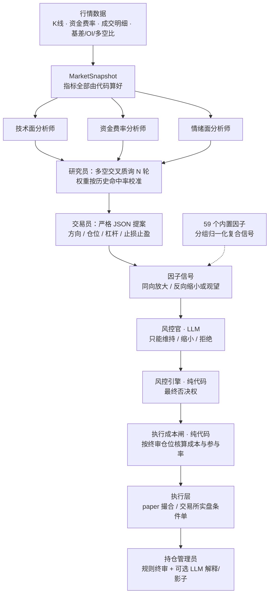

# QeeLin-Agent

<p align="center">
  <a href="LICENSE"></a>
  
  
  
</p>

币圈永续合约的**多智能体交易框架 + 自动因子研究循环**。

> **核心原则：数字由代码算，语言交给模型。** LLM 负责解释与权衡，不负责算术，也没有下单权限。开仓后的移动止损、时间止损、趋势反转退出，以及成本 / 流动性检查，全部是确定性代码。

决策链：三位分析师并发 → 多空辩论 → 交易员输出 JSON 提案 → 风控官复核 → **确定性风控引擎终审** → **执行成本闸**（定最终仓位）；开仓之后由**持仓管理员**接管退出决策，可选用 LLM 写解释或做**影子复核**（只记日志，绝不改动作）。研究循环让模型自己写因子、跑回测，按样本外表现决定是否晋级。


---

## v1.1.5 更新要点

- **侧栏常驻「已运行时长」**：`/api/status` 新增 `uptime_sec` / `started_at`，页面每轮轮询刷新，
  悬停可看启动时刻。重启会丢 arm 状态、清空缓存，排查异常时第一眼就能确认是不是刚重启。
- **全品种预热报价间隔默认收紧**：`cache_warm_interval_sec` 线上调为 5 秒（6 品种 ≈ 72 weight/min，
  远低于币安 2400 上限），机会榜与标记价更跟手。

## v1.1.4 更新要点

- **全品种缓存预热**：后台线程按 15 秒 / 5 分钟 / 5 分钟三档节流，keep 住全部可交易品种
  的报价、主周期与短周期 K 线。高频档一轮依次评估多个品种时，切换只读本地盘缓存，
  不再在决策中途重下 6000 根 K 线。
- **缓存写入改为原子替换**：`load_market` 落盘不再直接 `to_csv`，避免预热线程与页面/决策
  同时读写同一份 CSV 时读到半截文件。

## v1.1.3 更新要点

- **配置方案**：内置「稳健 / 高频稳健 / 保守」三套，一键套用、一键恢复默认、一键撤销上次改动。
  方案**只覆盖风控 / 持仓 / 选品三组**，代码级拒绝任何含 API Key、provider、model 的字段
  （导入时校验 + 应用前二次校验）。
- **LLM 自主调参**：模型读近期平仓绩效与决策漏斗，提出小幅调整；能否落地由代码裁决——
  白名单数值项、单次 ≤ 25%、一轮 ≤ 3 项、越界即整份作废、改动后仍须满足保证金不等式。
  支持手动评估与每日自动，每次改动写入审计历史可回滚。
- **交易频率**：新增 `market.auto_top_k`，一轮可依次评估多个品种（原先一轮只看一个）。
- **因子库 43 → 59**：补 1 周动量、距区间高点、费率×滞涨、费率×OI 拥挤、基差动量，
  以及 ADX / Aroon / Choppiness / Keltner / CCI / Roll 价差 / Elder 力度 / CMF /
  收益自相关 / ATR 期限结构 / RSI 背离；新增全库沙箱健康检查。

## v1.1.2 更新要点

- **持仓管理员接入 LLM（两档，默认关）**：`llm_explain` 只写「为什么这样管」的解释；`llm_shadow` 额外让模型给一份独立退出意见——**只记日志与页面展示，永不改变规则动作**。两档共用一次调用，带峰谷闸门（谷时半价）、每品种冷却与用量统计。
- **设置页热更新**：新增 `GET/POST /api/settings/position`，LLM 开关、冷却间隔、规则层参数改完**立即生效、无需重启**；越界输入整体回滚并返回 400。
- **规则层参数化**：持有根数改按 K 线索引统计（墙钟仅兜底）、趋势反转 EMA 跨度可配、因子复合信号加过期保护、新增「峰值回撤退出」（默认关，需模拟盘验证后再开）。
- **决策页重构**：新增「LLM 影子复核」卡片；PC 端与「多品种扫描」**并排、等高、各自滚动**；整页卡片间距与内边距收紧（实测省约 16% 高度）。
- **移动端细节**：多品种扫描改为一条记录一张卡片，理由「标签与正文同行」且超 3 行才折叠、可展开；时间戳只显示时间；卡片头按钮不再被时间戳挤到下一行。
- **交易页修正**：最近成交里开仓记录的盈亏列不再显示误导性的 `0.00`，改为显示「开仓」（兼容交易所回读成交，其动作为「买入 / 卖出」且已实现盈亏为 0）。
- **设置页整理**：子菜单统一四字（交易链接 / 交易参数 / 模型设置 / 情绪新闻 / 通知告警）；模型设置拆成「LLM 模型设置」与「持仓管理员 · LLM 接入」两张独立卡片，各自保存；修复保存成功无提示的问题。

---

## 目录

- [设计原则](#设计原则)
- [核心特性](#核心特性)
- [架构](#架构)
- [快速开始](#快速开始)
- [命令行](#命令行)
- [Web 控制台](#web-控制台)
- [运行模式与安全闸门](#运行模式与安全闸门)
- [风控体系](#风控体系)
- [持仓管理员](#持仓管理员)
- [执行成本闸](#执行成本闸)
- [分析师权重校准](#分析师权重校准)
- [因子研究循环](#因子研究循环)
- [行情数据与缓存](#行情数据与缓存)
- [交易所支持](#交易所支持)
- [LLM 与成本控制](#llm-与成本控制)
- [通知](#通知)
- [配置](#配置)
- [目录结构](#目录结构)
- [测试](#测试)
- [已知限制](#已知限制)
- [版本历史](#版本历史)

---

## 设计原则

| 原则 | 落地方式 |
|---|---|
| **数字归代码** | 价格、均线、ATR、资金费率 z-score、仓位、盈亏、回撤全部由 pandas 计算后喂给模型；模型只输出判断与理由 |
| **确定性兜底** | 每个角色都有规则化实现：没配 Key、网络失败、输出不合规都会自动降级，流水线不中断，报告标注「LLM 降级」 |
| **偏保守的默认** | 默认 `paper` + `mock` 模式，开箱即跑、零成本、不联网下单；实盘需要两道显式解锁 |
| **可插拔** | LLM / 交易所 / 通知 / 情绪源任一缺失都能降级运行 |
| **可审计** | 每次决策落盘为 JSON + Markdown，成交记录保留计划价、滑点、手续费与已实现盈亏；持仓管理员的 LLM 用量与影子记录同样落盘 |

---

## 核心特性

- **多智能体决策链**：技术面 / 资金费率 / 情绪面三位分析师并发，多空双方交叉质询，交易员输出严格 JSON 提案，风控官独立复核；分析师权重按历史方向命中率事后校准。
- **独立风控引擎**：纯代码实现，拥有最终否决权；风控官只能维持、缩小或拒绝提案，**不能放大**。
- **执行成本闸**：开仓前用代码核算手续费、滑点、资金费与冲击成本，净边际为负或参与率过高直接拒绝 / 缩仓，且**在风控终审之后**决定最终仓位，不会被上游覆盖。
- **持仓管理员**：浮盈达 1R 后移动止损保本并跟踪 ATR 极值、横盘超时退出、趋势反转或因子强反向提前退出；可选 LLM 解释与影子复核。实盘撤旧条件单重挂，挂单失败自动回退旧止损。
- **自动因子研究**：模型写因子代码 → AST 白名单 + 独立子进程沙箱 + 未来函数检测 → 训练 / 验证 / 测试三段回测 → 按样本外夏普加权晋级。
- **59 个内置因子**：35 个经典 OHLCV + 13 个微观结构 + 4 个主动买卖 / 成交明细 + 7 个衍生品（基差、基差动量、持仓量、费率×OI 拥挤度、taker 多空比、账户多空比）；缺数据列的因子整体跳过，不稀释信号。
- **多交易所**：币安 U 本位合约（Demo / Testnet / 主网）与 OKX 永续（模拟盘 / 主网）。模拟盘与主网使用**两套独立 Key**，互不回退。
- **本地 Web 控制台**：总览、交易、决策、因子研究、设置五个页签，纯静态资源，无需前端构建；移动端单独适配。
- **峰谷调度**：按 DeepSeek 官方峰谷时段安排可延后的研究任务与持仓管理员调用，谷时半价。
- **通知渠道**：控制台、应用内、Webhook、Telegram、邮件。

---

## 架构



每个环节的输出都会写进决策报告；任何一步失败都退回该环节的确定性实现。持仓期间不再跑开仓决策（省掉 LLM 调用，也不会重复推送风控拦截通知），改由持仓管理员做退出判断。

> 公开接口 `run_decision()` 在持仓期间返回 `skipped`，但**持仓管理员仍然运行**，由独立守护线程每 30 秒驱动一次，不依赖自动交易循环。


---

## 快速开始

**要求**：Python 3.10+，核心依赖只有 `numpy`、`pandas` 与 `certifi`（根证书，缺失时部分 HTTPS 源会 `CERTIFICATE_VERIFY_FAILED`）。

```bash
git clone https://github.com/QeeLin-AI/qeelin-agent.git
cd qeelin-agent

python -m venv .venv
# Windows
.venv\Scripts\activate
# macOS / Linux
source .venv/bin/activate

pip install -r requirements.txt
```

**离线跑通全流程（不联网、不花钱）**：

```bash
python run.py demo
```

默认 `--source synthetic --llm mock`：用合成行情 + 规则引擎跑完研究、回测与决策，产出完整报告。

**接真实行情**：

```bash
python run.py demo --source binance --symbol BTCUSDT --bars 6000
```

**接真实模型**（任何 OpenAI 兼容网关）：

```bash
cp .env.example .env
# 编辑 .env：CRYPTOAGENT_LLM_PROVIDER=openai，并填入 OPENAI_API_KEY
python run.py agents --llm openai
```

**启动 Web 控制台**：

```bash
python run.py web --host 127.0.0.1 --port 8000
```

控制台默认只监听回环地址，并使用访问令牌鉴权；`python run.py token` 可打印带令牌的完整地址。注意：`deploy/qeelin-agent.service` 为了配合云服务器直连，显式传了 `--host 0.0.0.0`（见「服务器部署」一节），此时必须设置 `CRYPTOAGENT_WEB_TOKEN`，且应只通过安全组放行 8000 或改用 nginx 反代。

---

## 命令行

安装（`pip install -e .`）后可用 `cryptoagent`，等同于 `python run.py`。

| 命令 | 作用 |
|---|---|
| `demo [-n N]` | 端到端演示：因子研究 → 回测 → 决策 |
| `research [-n N]` | 因子研究循环，产出候选因子并回测晋级 |
| `backtest --factor NAME` / `--code FILE` | 回测单个因子 |
| `agents [--rounds N]` | 跑一次多智能体决策并输出报告 |
| `web [--host H] [--port P] [--no-browser]` | 启动本地 Web 控制台 |
| `download [--symbol S] [--bars N]` | 下载并缓存行情 |
| `exchtest [--envs demo testnet live]` | 用 `.env` 里的 Key 试连交易所，翻译错误码 |
| `token [--port P]` | 打印带访问令牌的控制台地址 |
| `llmtest [--provider] [--model]` | 体检：模型能否调用、延迟、token 与日成本估算 |
| `netcheck [--symbol S]` | 体检：行情 / 下单 / 实时价各域名连通性 |
| `factors` | 列出内置因子 |

公共参数：`--source {synthetic,binance}`、`--bars`、`--symbol`、`--llm {mock,openai}`、`--refresh`。

---

## Web 控制台

纯静态资源（`index.html` + `app.js` + `style.css`），无需前端构建；`python run.py web` 默认只监听回环地址并使用访问令牌鉴权（systemd unit 例外，见「服务器部署」）。

| 页签 | 内容 |
|---|---|
| **总览** | 账户权益、当日盈亏、回撤、当前持仓、权益曲线、最近成交、机会信号打分榜、持仓管理巡检 |
| **交易** | 解锁与模式切换、开平仓、订单计划、持仓历史、最近成交、通知列表 |
| **决策** | 决策全过程（分析师结论 → 多空辩论 → 交易员提案 → 风控官 → 风控引擎 → 成本闸 → 仓位归因）；多品种扫描与 LLM 影子复核 |
| **因子研究** | 迭代研究、候选因子排行榜（IS/OOS 夏普、OOS 回撤、评分、结论）、冠军因子代码 |
| **设置** | 交易链接 / 交易参数 / 模型设置 / 情绪新闻 / 通知告警 五个子页 |

**决策页布局**：PC 端「多品种扫描」与「LLM 影子复核」并排、等高，内容超出时各自内部滚动（表头吸顶）；移动端（≤860px）自动堆叠。扫描表在移动端改为「一条记录一张卡片」，理由与标签同行、超过 3 行折叠为可展开，避免长文案把行撑高。

**成交展示**：最近成交按「时间段 + 品种 + 方向」合并同批下单；开仓记录没有已实现盈亏，盈亏列显示「开仓」而不是 `0.00`。


服务与接口全部使用 Bearer / `?token=` 鉴权。`python run.py web` 默认绑定 `127.0.0.1`；`deploy/qeelin-agent.service` 绑定 `0.0.0.0:8000`（云服务器场景），因此部署时必须设置令牌，并在安全组只放行必要端口。

---

## 运行模式与安全闸门

| 模式 | 说明 | 是否动用真钱 |
|---|---|---|
| `paper` | 本地模拟撮合，含手续费与滑点模型 | 否 |
| `testnet` / `demo` | 交易所模拟盘（币安 Demo、OKX 模拟盘） | 否 |
| `live` | 交易所主网真实下单 | **是** |

进入 `live` 需要同时满足两个闸门，缺一不可：

1. `.env` 中设置 `CRYPTOAGENT_I_UNDERSTAND_THE_RISK=yes`；
2. 项目根目录存在空文件 `.cryptoagent_live_ack`。

此外，模拟盘与主网是**两套独立 Key**，代码不会在两者之间回退：模拟盘缺 Key 时直接报错，而不是悄悄改用主网 Key 下单。

**熔断开关**：`runs/TRADING_HALT` 存在时拒绝所有新开仓，控制台可一键切换。

---

## 风控体系

风控分两层：**LLM 风控官**（只能收紧）+ **确定性风控引擎**（最终否决）。风控引擎通过后，才由执行成本闸按终审仓位做最后一道成本核算。

| 参数 | 出厂值 | 含义 |
|---|---|---|
| `max_leverage` | 20 | 杠杆上限（与交易所支持的最大值取较小值） |
| `leverage_override` | 0 | 0 = 跟随决策；>0 = 强制使用该杠杆 |
| `min_leverage` | 1 | 杠杆下限（1 = 不干预） |
| `sizing_mode` | `llm` | 仓位怎么定：`llm` 听交易员 / `risk` 按单笔风险上限反推 |
| `max_position_pct` | 0.8 | 单笔最大保证金占用（占权益）。同时决定单笔最大名义 = `max_position_pct × max_leverage` |
| `max_loss_per_trade_pct` | 0.02 | 单笔最大亏损（按仓位 × 杠杆 × 止损计算） |
| `daily_loss_limit_pct` | 0.05 | 单日亏损上限，触发后停止开仓 |
| `max_drawdown_pct` | 0.2 | 最大回撤上限 |
| `min_confidence` | 0.45 | 低于该置信度直接放弃 |
| `max_portfolio_notional_pct` | 16.0 | 全部持仓名义敞口上限（倍权益）；须 ≥ 单笔最大名义 |
| `correlated_exposure_pct` | 16.0 | 同一相关性组内同向敞口上限（倍权益）；同上须 ≥ 单笔最大名义 |
| `max_concurrent_positions` | 1 | 同时持仓品种数上限；`1` = 单仓，多仓需手动打开 |
| `max_margin_usage_pct` | 0.95 | 全部持仓的保证金占用上限（占权益）。交易所拒单看的是这个，不是名义敞口 |

> 上表是 `config/default.example.json` 的出厂值；代码内 dataclass 兜底更保守（3x / 30% / 1% / 3% / 15% / 0.55）。`config/default.json` 是**运行时文件**（设置页会就地改写，仓库不跟踪），首次部署从 example 复制；缺字段时以代码默认为准，因此**升级不需要改旧配置**。6 项硬顶（单笔风险 / 单笔仓位 / 同时持仓品种数 / 保证金占用 / 当日亏损 / 最大回撤）都可在控制台调整；组合层两项单位为**倍权益**，可在 **0.1–100x** 设置——设得大只是放宽允许范围，不代表实际会用满。

> **硬约束：`max_position_pct × max_concurrent_positions ≤ max_margin_usage_pct`。** 否则「允许开 N 仓」是假承诺：按单笔上限开满时保证金必然不够，第 N 仓会被组合层拒掉。控制台在这条不成立时拒绝保存（前端先提示、`/api/risk` 再硬拦一道），校验失败整体回滚。

**`sizing_mode = risk` 的行为**：按「单笔最大亏损 ÷ 止损幅度 ÷ 杠杆」反推数量，**无条件覆盖**交易员 / 因子 / 风控官给的仓位，只保留方向与拒绝结论；决策页的「仓位归因」会明写「覆盖上游建议仓位」。注意在这种模式下，单笔风险只由 `max_loss_per_trade_pct` 决定，杠杆改变的是保证金占用与订单字段，不放大风险。

**多品种并发持仓**：`max_concurrent_positions > 1` 时，持仓存在 `state["positions"]`（按品种索引），同一品种只允许一笔。开新仓受三道闸约束——品种数上限、保证金占用上限、组合名义敞口上限。**多仓时务必同步下调 `max_loss_per_trade_pct`**：单笔 5% 风险在 3 个品种同时打满止损时就是 15%。

> 名义 = 数量 × 开仓价，与杠杆无关；保证金 = 名义 ÷ 杠杆。旧版曾把名义多乘一次杠杆，导致敞口虚高 lev 倍，已修正。

其他保护：

- **持仓核对**：开仓、换品种、删品种前与交易所核对真实持仓，自动清理「本地记着、交易所已平」的幽灵仓位，且不会替用户主动平仓。
- **交易所侧平仓补记**：止损 / 止盈由交易所条件单成交后回读 `userTrades`，以开仓订单号为时间下界聚合，补写 fills、持仓历史与已实现盈亏。
- **实盘权益对齐**：实盘以交易所余额 + 未实现盈亏作为权益口径，避免用模拟账本本金计算仓位。
- **成交回读**：开平仓后按订单号回读交易所成交，回填真实成交均价、手续费与已实现盈亏（币安 `userTrades` 默认时间升序，需自行倒序）。
- **通知去重**：同一品种 + 同一拦截原因 30 分钟内只报一次。


---

## 持仓管理员

开仓后不再只靠一张静态条件单。持仓期间 `run_decision()` 跳过开仓决策，改由**持仓管理员**（`agents/position_manager.py`）做退出判断。**动作始终由确定性规则终审**，LLM 只有解释权。

| 规则 | 触发条件 | 动作 |
|---|---|---|
| 移动止损 | 浮盈 ≥ `trail_activate_r` × R（默认 1R） | 止损先上移到保本，再按 `trail_atr_mult` × ATR 跟踪开仓以来的极值；**只往有利方向移动**，改善不足 `trail_min_gap_pct` 就跳过 |
| 时间止损 | 持有 ≥ `max_hold_bars` 根且浮盈 < `min_progress_r` × R | 平仓，释放资金 |
| 趋势反转 | 至少持有 `reversal_min_hold_bars` 根，价格跌破慢均线且近 3 根继续反向；或因子复合信号与持仓方向强反向（默认 \|composite\| ≥ 0.7） | 提前平仓，不等静态止损 |
| 峰值回撤 | 浮盈曾达 1R、随后自高点回吐 `peak_drawdown_r` × R（**默认关**） | 提前退出保住利润；只针对已有盈利的仓位，不把正常震荡当反转 |

> **R** = 开仓时 `|entry − stop| / entry`，开仓瞬间固化，因此不同杠杆、不同止损宽度的仓位共用一套参数。规则算不出结论一律 `hold`；整个函数包在 `try/except` 里，计算异常同样退化为 `hold`，绝不因旁路故障中断主流程。

**规则层可调项**（`config.position`）：

| 字段 | 默认 | 说明 |
|---|---|---|
| `bars_from_index` | 开 | 持有根数按 K 线索引里开仓之后的 bar 数统计；K 线数据早于开仓时回退墙钟估算 |
| `reversal_ema_bars` | 48 | 趋势反转用的慢均线跨度（bar 数），不再硬编码 |
| `composite_max_age_sec` | 300 | 因子复合信号超过该时长不再用于退出判断，避免拿过期信号误平 |
| `peak_drawdown_exit_enabled` / `peak_drawdown_r` | 关 / 1.0 | 峰值回撤退出，属新增交易行为，建议先模拟盘验证 |

### LLM 接入（两档，默认关）

| 开关 | 作用 | 是否影响动作 |
|---|---|---|
| `llm_explain` | 为已触发的动作生成一段「为什么这样管」的解释 | **否**，只写报告与页面 |
| `llm_shadow` | 让模型独立给一份退出意见（close / tighten / hold + 置信度 + 理由） | **否**，只记日志，页面「LLM 影子复核」可对照 |

- 两档**共用同一次** `review_management()` 调用，不会为解释多花一次 token；
- `llm_offpeak_only`（默认开）峰时跳过，等谷时半价再跑；`llm_min_interval_sec`（默认 900 秒 / 品种）做冷却；
- 与决策链共享同一个 `LLMClient`，用量（调用 / 峰时跳过 / 冷却跳过 / 失败）随状态落盘，`/api/status` 的 `position_llm_usage` 可查；
- 影子记录保留最近 50 条，`position_llm_shadow` 取最近 10 条，字段含 `rule_action` / `rule_reason` / `llm_action` / `confidence` / `reason` / `degraded`。

设置页「模型设置 → 持仓管理员 · LLM 接入」可热更新（`GET/POST /api/settings/position`）。WebApp 与引擎共享同一个 `AppConfig`，所以**改完立即生效，无需重启**；数值越界整体回滚并返回 400。

### 实盘改单的安全性

实盘由 `live_stop_adjust` 控制是否**撤掉旧条件单、按新止损重挂**（同方向只能有一张 `closePosition` 单）：

- 新止损挂不上 → **立刻回退挂旧止损**并发 critical 告警，绝不留裸仓；
- 止盈重挂失败 → 标记 `tp_pending` 并发 critical 告警，由守护线程下一轮补挂；
- `min_adjust_interval_sec`（默认 300 秒）防止每轮反复改单。

持仓管理由**独立守护线程**驱动（默认 30 秒一次），不依赖「启动自动交易循环」——手动 / 半自动模式下开仓后同样生效；线程内有防重入锁，不会与自动循环重复改单。去重与冷却状态随引擎状态落盘，重启后不会立刻重复推送或改单。

> 页面展示的「最近动作」单独留档（`position_management_last`），不会被 30 秒后的 `hold` 覆盖；多仓时还有逐品种巡检（`position_managements`）。

---

## 执行成本闸

`costs.py` 在**风控引擎终审之后**运行，用最终 `size_pct` / `leverage` 核算「占名义敞口」的成本——这个顺序是刻意的：若放在风控之前，`sizing_mode=risk` 的反推会覆盖成本闸的缩仓结论。

| 项 | 口径 |
|---|---|
| 手续费 | 开 + 平 = `2 × fee_bps` |
| 滑点 | 开 + 平 = `2 × slippage_bps` |
| 资金费 | `\|近期费率均值\|` × 预期持有小时 / 8，持有时间由「止盈幅度 ÷ ATR」估计 |
| 冲击成本 | 参与率 = 单笔名义 / 最近一根 K 线成交额；超过 `max_participation` 时按反比缩仓，超过 `max_participation_hard` 直接拒绝 |

净边际（止盈 − 成本）≤ 0 → 拒绝；成本占预期收益超过警戒线只提示不缩仓（按比例计的成本不会随仓位变小而改善）。数据缺失时**保守放行并标记**，绝不误拒。

配置位于 `config/default.json → backtest.costs`：`cost_gate_enabled`（开）/ `max_cost_ratio`（0.35）/ `max_participation`（0.10）/ `max_participation_hard`（0.50）。

---

## 分析师权重校准

辩论评分原来是写死的 `0.5 × 技术 + 0.3 × 资金费率 + 0.2 × 情绪`，现在改为**事后校准**（`agents/calibration.py`）：

1. 开仓时把三位分析师的 `stance` 存进仓位；
2. 平仓时按「退出价相对开仓价的市场方向」评判每个分析师看对没有——用市场方向而不是这笔仓的盈亏，因为开仓方向由交易员决定；
3. 累计命中率，用拉普拉斯平滑 + 与先验各占一半的混合方式生成新权重。

保守约束：中性立场（`|stance| < 0.05`）不计数；累计不足 **10 笔**时完全沿用默认权重；权重恒在 `[0.1, 0.7]`，不会让单一角色一家独大。统计存在 `state["analyst_accuracy"]` 随状态落盘，`/api/status` 的 `analyst_calibration` 可查看当前权重与命中率。

---

## 因子研究循环

```
写代码  →  静态校验  →  沙箱执行  →  未来函数检测  →  三段回测  →  晋级 / 淘汰
```

1. **写代码**：模型按模板输出 `factor(df) -> pd.Series`。
2. **静态校验**：AST 白名单，只允许数学运算与控制流，禁止 `import`、`class`、`with`、下划线属性，阻断常见逃逸写法。
3. **沙箱执行**：独立子进程 + 受限 `__builtins__`（无 `open` / `eval` / `exec`）+ 超时强杀。
4. **未来函数检测**：用前 k 根 K 线重算，若最后一位与全量结果不一致，判定偷看未来并淘汰。
5. **三段回测**：train / valid / test 切分，只有样本外（OOS）夏普超过阈值才入库；入库因子权重 = 留出集夏普，负值直接权重 0。

### 内置因子库（59 个）

| 档 | 数量 | 数据依赖 | 例子 |
|---|---|---|---|
| 经典 OHLCV | 35 | open/high/low/close/volume/funding_rate | 动量、RSI、MACD、布林、ATR 突破、MFI、ADX、Aroon、Choppiness、Keltner、CCI、Roll 价差、Elder 力度、Chaikin 资金流 |
| A 档微观结构 | 13 | 同上 | 换手率波动、Amihud 非流动性、方差比、Kaufman 效率比、偏度 / 峰度、Parkinson / Garman-Klass 波动、VWAP 偏离 |
| B 档成交明细 | 4 | K 线 API 原生返回的 `taker_base` / `quote_volume` / `trades` | 主动买占比、订单流不平衡、平均单笔规模、换手率异常 |
| C 档衍生品 | 7 | 基差 / 持仓量 / taker 多空比 / 账户多空比 | 基差 carry、基差动量、OI 动量、价涨仓跌背离、费率×OI 拥挤度、taker 多空比、账户多空比 |

所有内置因子**全量参与**信号合成（旧版 `top_n=8` 会截断到字典里最前的几个，已修复）。权重采用**分组归一化**：内置组与研究组各自在组内归一化，再按 内置 0.6 / 研究 0.4 合成，避免「人为写的 1.0」与「回测夏普」两种量纲直接混算。数据源缺列时，依赖该列的因子整体跳过；因子值恒为常数的也跳过，不会用一堆 0 稀释复合信号。

`data.py` 保留 K 线 API 返回的成交明细列，`factors/sandbox.py` 的列白名单同步登记——**新增数据维度必须同时改这两处**。`derivatives.py` 从币安公开端点对齐衍生品维度，5 分钟缓存、失败静默降级，只在主行情刷新时拉取（多品种机会扫描不拉）。

第二批（2026-11，+16 个）按公开研究补维度，而不是重复堆技术指标：1 周动量与「距区间最高价」对应 Liu–Tsyvinski–Wu（*Journal of Finance* 2022）在加密横截面上最显著的几个因子；「费率高位 × 价格滞涨」「费率 × OI 拥挤」「基差动量」对应永续合约实务研究里「费率水平在 8 小时尺度比 z-score 更有预测力、基差压缩领先于反向」的结论；其余补上经典技术分析长期缺位的趋势强度（ADX）、趋势新鲜度（Aroon）、盘整判别（Choppiness）、ATR 通道（Keltner）、CCI、Roll 隐含价差、Elder 力度、Chaikin 资金流、收益自相关、ATR 期限结构、RSI 背离。全部 `validated=False`，按 0.25 权重参与——16 个合计约占复合信号 13%，已验证的 21 个各稀释约 13%。

`tests/test_factor_library.py` 会用合成行情把全库跑一遍并断言「没有错误、不是常数」，因为因子是一段段独立代码字符串，写错只会在运行期暴露，而信号层会把它**静默降权为 0**——不测就表现为「因子越加越多，复合信号却没变化」。

### 候选因子验证

新加入且未经 OOS 验证的因子以 **0.25 权重**参与（老因子为 1.0），不会因「论文说有效」就直接主导信号：

```bash
python tools/validate_factors.py --bars 6000                  # 只出报告
python tools/validate_factors.py --bars 8000 --symbol ETHUSDT --write
```

脚本从 `data-api.binance.vision` 分页拉真实 K 线（无需 Key），通过门槛（IS > 0、OOS ≥ `min_oos_sharpe`、test 夏普 > 0 且衰减不过半）的因子写入 `factors/validated.json` 并提升权重；`--include-validated` 可把老因子一起跑作对照。

> **实测结论（BTCUSDT 1h，6000 根）**：17 个新候选因子 **0 个通过**，对照组 21 个老内置因子同样 **0 个通过**，且 IS 夏普几乎全为负。这说明单因子三段回测在加密永续上给出的绝对夏普不可靠，只能用于候选之间的相对排序。因此 `validated.json` 通过名单为空，新因子保持降权参与，既没有强行提升也没有删除。

**性能说明**：单因子沙箱的主要成本是子进程启动（约 1.25 秒 / 因子，与数据量无关），因此信号计算与候选验证都采用**批量执行**——同一子进程内依次跑完全部因子，59 个约 1 秒，全品种扫描从分钟级降到十几秒。

---

## 行情数据与缓存

**主行情**（默认 `1h` × 6000 根）在 `load_market()` 里落成 `data/cache/{symbol}_{interval}_{bars}.real.csv`，末根落后超过 2 根就重新下载；下载失败时沿用旧缓存并在页面顶部标注「旧缓存」。合成数据写独立的 `.synthetic.csv`，**永远不会冒充真实行情**。

**短周期 K 线**（页面 `/api/klines`、决策里的中频突破信号）走 `fetch_klines()` 的三级取数：

| 层 | 有效期 | 说明 |
|---|---|---|
| 进程内 | 15 秒 | 挡住页面 3 秒轮询的重复请求 |
| 落盘 CSV | 半个 bar，封顶 3 分钟 | `data/cache/klines/{symbol}_{interval}_{limit}.{binance\|okx}.csv`，同周期内零网络 |
| 交易所 | — | 盘缓存过期后整段重拉一次并**原子覆盖**，不做增量拼接 |

- **交易所隔离**：币安与 OKX 分开存文件，切交易所绝不会读到另一家的价格。
- **盘缓存新鲜度按文件 mtime 判定**：按最后一根 bar 的开盘时刻判会把当前未收盘的那根永久判成过期。
- **后台预热**：主行情每次刷新后，把 `short_interval` 与 `klines_prewarm_intervals`（默认 `["15m"]`）的 K 线焐热，按盘缓存有效期节流。只在主行情刷新时触发，多品种机会扫描不预热，避免数倍请求。
- **口径一致**：中频突破信号用的 `prefer` 跟随当前下单交易所，避免在 OKX 上错配币安行情。
- **取价实时性**：持仓现价由报价线程每 4 秒拉一次 `/ticker/price`，不走 30 秒持仓轮询；非活跃品种**不能用 `fetch_klines` 当现价**（会拿到半根 bar 的收盘价）。页面可用 `mark_ts` / `quote_guard` 判断新鲜度。
- 缓存文件损坏 / 条数不足 / 写了一半，一律当作没有缓存，退回网络重拉。
- **备用源不被 WAF 误杀**：主接口失败按 `fapi → demo → Gate 永续` 回退。Gate 的 WAF 按 UA 指纹拉黑旧浏览器版本，因此 UA 固定为近期版本，403 时换一个无浏览器指纹的兜底 UA 重试一次；429 / 5xx 不重试，直接交给下一个源。

```jsonc
// config/default.json → market
"short_interval": "5m",             // 中频信号周期（默认 5m，可改 15m）
"klines_cache": true,               // 短周期 K 线落盘
"klines_prewarm": true,             // 主行情刷新后后台预热
"klines_prewarm_intervals": ["15m"] // 除 short_interval 外额外保持预热的周期
```

> `INTERVAL_HOURS` 必须覆盖 `1m / 3m / 5m`，缺项会被 fallback 成 1h，导致翻页步长与缓存时效算错。

---

## 交易所支持

| 交易所 | 环境 | 需要的变量 |
|---|---|---|
| Binance U 本位合约 | Demo / Testnet | `BINANCE_DEMO_API_KEY` / `BINANCE_DEMO_API_SECRET` |
| Binance U 本位合约 | 主网 | `BINANCE_API_KEY` / `BINANCE_API_SECRET` |
| OKX 永续 | 模拟盘 | `OKX_DEMO_API_KEY` / `OKX_DEMO_API_SECRET` / `OKX_DEMO_PASSPHRASE` |
| OKX 永续 | 主网 | `OKX_API_KEY` / `OKX_API_SECRET` / `OKX_PASSPHRASE` |

签名方式为 HMAC-SHA256。API Key 建议**只勾选读取与合约交易**，不要开提现权限，并尽量绑定出口 IP 白名单。OKX 模拟盘请求需带 `x-simulated-trading: 1`；部分字段可能返回空串，统一安全转换。

---

## LLM 与成本控制

- 支持任何 OpenAI 兼容接口；默认 `provider=mock`（规则引擎，零成本），可切换 `openai`。
- 输出经过 schema 校验与重试，畸形 JSON 不会变成订单。
- 单模型多角色：「多智能体」是同一模型套不同 SYSTEM 提示词、共用温度，不是多个模型。
- **峰谷调度**（DeepSeek 官方计价规则）：峰时为工作日 09:00–12:00、14:00–18:00（北京时间，法定节假日除外），其余时间及周末为谷时，价格减半。
  - `offpeak_research_only`（默认开）：因子研究可延后，只在谷时调用 LLM，峰时改用模板提议器；
  - `peak_mode`：`full`（默认，实时决策照常）/ `thrift`（峰时降级为规则兜底，报告标注降级）；
  - 持仓管理员的 `llm_offpeak_only` 独立于以上两项，只影响它自己的调用。

---

## 通知

支持 `console`、`inapp`（应用内列表）、`webhook`、`telegram`、`email`。任一渠道配置失败只影响该渠道，不会中断交易主链路。应用内通知可在控制台一键清除。

---

## 配置

两层配置：

- `config/default.json`：品种列表、周期、风控阈值、研究参数等**非敏感**配置，控制台修改后回写。该文件**不入库**（`.gitignore`），仓库里只保留 `config/default.example.json` 作为出厂模板；首次部署时 `install.sh` 会自动复制一份。
- `.env`：所有密钥与连接信息，**不会入库**（`.gitignore` 已忽略，仓库仅保留 `.env.example` 模板）。

常用环境变量：

| 变量 | 说明 |
|---|---|
| `CRYPTOAGENT_LLM_PROVIDER` / `_MODEL` / `_BASE_URL` | 模型提供方、模型名、网关地址 |
| `OPENAI_API_KEY` | 模型密钥（变量名可配置） |
| `BINANCE_*` / `OKX_*` | 交易所密钥，见上一节 |
| `CRYPTOAGENT_WEB_TOKEN` | 控制台访问令牌（URL 即密码：带 token 换取 Cookie） |
| `CRYPTOAGENT_CONFIG` / `CRYPTOAGENT_ENV_FILE` | 自定义配置与 env 文件路径 |

> `.env` 与 `config/default.json` 都属于运行时文件，**都不入库**。服务器升级用 `deploy/update.sh`：它会在 `git reset` 前备份 `config/default.json`、reset 后立即恢复，并把权限交回服务账号；`deploy/install.sh` 的 rsync 也显式排除了这个文件。<br>
> ⚠️ 反向代理不是必需的，但如果用 `deploy/nginx.conf`，请把 unit 的 `--host` 改回 `127.0.0.1`——否则 `http://IP:8000` 可以绕过 nginx 的 IP 白名单与 Basic Auth，只剩令牌一道防线。

---

## 目录结构

```
src/cryptoagent/
├── agents/            # llm 客户端、roles 角色提示词、pipeline 编排、
│                      #   position_manager 持仓管理员、calibration 权重校准
├── factors/           # library 内置因子（59 个）、sandbox 沙箱、signal 信号合成、
│                      #   shortterm 短周期、validate 三段验证、validated.json
├── web/               # 本地 HTTP 服务 + 静态前端（server.py / static）
├── engine.py          # 交易引擎：状态机、开平仓、自动循环、机会扫描、平仓补记
├── execution.py       # 交易所客户端：签名、下单、止损止盈、持仓、成交、行情
├── risk.py            # 确定性风控引擎与账户状态
├── costs.py           # 执行成本闸：手续费 / 滑点 / 资金费 / 冲击成本
├── derivatives.py     # 衍生品数据：基差、OI、taker 多空比、账户多空比
├── research.py        # 因子研究循环
├── backtest.py        # 回测与「因子值 → 目标仓位」转换
├── data.py            # 行情加载、成交明细、缓存与合成数据
├── sentiment.py       # 情绪 / 新闻源（无 Key 时用价格行为代理）
├── notify.py          # 通知渠道
├── config.py          # 配置模型与读写
└── cli.py             # 命令行入口
```

`tools/validate_factors.py` 是可选的候选因子验证脚本（拉真实行情跑三段回测），`desktop/` 是可选的 Electron 桌面壳（需自备 Node.js），`desktop_entry.py` 为打包用的后端入口。

## 服务器部署（Ubuntu 22.04 / 24.04）

```bash
# 首次部署（root）
sudo APP_DIR=/opt/crypto-agent bash deploy/install.sh
```

`install.sh` 会：装系统依赖与 chrony（签名时间戳偏差 >1s 会被交易所拒单）→ 建 nologin 服务账号 → rsync 代码（排除 `.env` / `data` / `runs` / `config/default.json`）→ 建 venv 装依赖 → 生成 48 位访问令牌写入 `.env` → 安装 `qeelin-agent.service`（`PYTHONPATH=/opt/crypto-agent/src`）→ 配 fail2ban 的 sshd jail → 打印访问地址。

```bash
# 更新（root，在服务器上）
sudo bash /opt/crypto-agent/deploy/update.sh
```

`update.sh` 会：清除历史 `skip-worktree` 标记 → 备份 `config/default.json` → `git fetch` + `reset --hard origin/main` → 恢复配置并交回服务账号 → 装依赖 → 同步 unit 并重启 → 检查 `systemctl status`，失败则回滚到更新前的 commit 并重启。

`deploy/` 下另有 Windows 侧脚本（`install-windows.ps1` / `setup-ssh-windows.ps1` 等）与可选 nginx 反代配置；`deploy/ssh-config.example`、`optimized.rdp` 是占位模板（`1.2.3.4` / `CHANGE_ME_IP`），不含真实地址。

---

## 测试

```bash
python -m pytest -q
```

**271 项单元测试**，覆盖风控限额与硬约束校验、因子沙箱与未来函数检测、回测指标、Web API 与鉴权、多仓位状态与报价解包、持仓核对与幽灵仓位清理、峰谷规则，以及持仓管理员的四类退出规则、LLM 解释 / 影子复核（含冷却、峰时跳过、失败降级）、执行成本闸、衍生品列对齐、分析师权重校准、平仓补记与成本闸终审顺序。测试使用合成数据与 mock 模型，不联网、不需要任何 Key。

---

## 已知限制

- **沙箱不是安全边界**：AST 白名单 + 子进程能挡住模型写出危险代码，但不防御恶意攻击者；真要运行不可信代码请放进容器并断网。
- **单因子三段回测不能当绝对准入门槛**：实测真实行情下新老因子几乎都无法通过 IS / OOS / test 全正的严格门槛（IS 夏普普遍为负）。这套协议适合**相对排序**，不适合断言某个因子「无效」。
- **实盘移动止损有短暂窗口**：调整止损需先撤旧条件单再重挂，存在毫秒级无保护窗口；新单失败会回退挂回旧止损并告警，但极端行情下仍有风险。
- **分批减仓未实现**：持仓管理只会全量平仓，并按交易所 `closePosition` 条件单联动。
- **衍生品数据依赖公网端点**：基差 / OI / 多空比来自币安公开接口，网络不通或地域受限时静默降级（对应因子整体跳过），此时信号只由 OHLCV 类因子构成。
- **单进程服务**：本地 HTTP 服务为单进程，CPU 密集任务（因子扫描、研究回测）已放到后台线程，但仍会与轮询争抢资源。
- **未做多账户 / 多策略并行**：一个进程对应一套配置；多品种靠 `state["positions"]` 与自动轮转实现。
- **不构成投资建议**：本项目用于研究与教学。加密货币合约风险极高，任何实盘损失由使用者自行承担。

---

## 版本历史

| 版本 | 要点 |
|---|---|
| **v1.1.5** | 侧栏运行时长（uptime_sec / started_at）；全品种报价预热间隔调至 5 秒 |
| **v1.1.4** | 全品种缓存预热（报价/主周期/短周期三档节流），`load_market` 缓存原子写入 |
| **v1.1.3** | 配置方案（稳健/高频/保守 + 恢复默认 + 撤销，硬约束不含密钥与模型配置）；LLM 自主调参（白名单/25%步长/3项上限/保证金交叉校验/审计回滚）；一轮多品种评估 `auto_top_k`；因子库 43→59 |
| **v1.1.2** | 持仓管理员接入 LLM（解释 / 影子复核）与设置页热更新；规则层参数化与峰值回撤退出；决策页重构（并排等高、紧凑化、影子复核卡片）；移动端扫描卡片化与理由折叠；成交表开仓标识修正 |
| v1.1.0-Beta | 控制台视觉重做（分组侧栏、五个页签、双主题）；默认风控上限自相矛盾修正 |
| v1.0.2 | 持仓管理员（退出决策）、执行成本闸、43 个内置因子、分析师权重事后校准 |

---

## License

[MIT](LICENSE)
